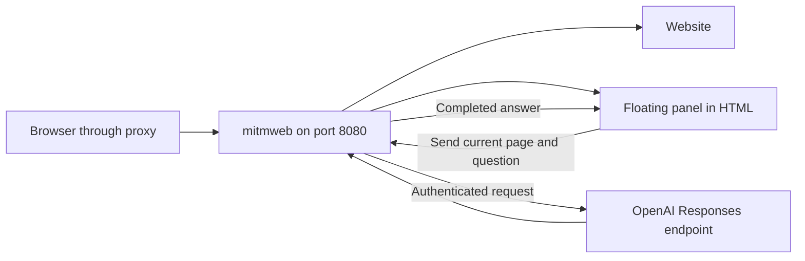

# Floating Page Reader

#i made this initally for lockdownbrowser, and it works below shows how it is injected

A floating webpage assistant powered by a local mitmproxy addon. Ask about the current page, read structured HTML content, and view answers without leaving the page.

**Package:** v5.10, saved-login edition · **Platform:** Windows · **Interface version:** `5.9`

This package attempts Sign in with ChatGPT and delegated model usage. Successful authentication, account eligibility, model catalog compatibility, and live answers have not been verified for this documentation. It does not provide an API-key fallback. OpenAI describes access for participating applications and eligible accounts; that does not establish support for this particular integration. See [OpenAI's sign-in documentation](https://help.openai.com/en/articles/20001410-sign-in-with-chatgpt).

## Features

- A draggable, translucent panel that starts as a minimized icon.
- Questions about the current page, with Enter to send and Shift+Enter for a newline.
- Empty-message reading: answer questions found on the page, or summarize a page without answerable questions.
- Structured extraction of headings, lists, tables, choices, labels, and supported math markup.
- Model selection from the account catalog returned at startup.
- Reasoning effort choices: Auto, Low, Medium, High, Extra High, and Max.
- Scrollable answer cards, a built-in on-screen keyboard, and a custom math renderer.
- Per-site position, model, and effort preferences when browser storage is available.
- A Windows DPAPI-encrypted login cache, updated when refresh tokens rotate.

## How it works



The panel reads the live HTML DOM when you press Send. The proxy handles its request locally, then sends the extracted text to OpenAI. OAuth tokens remain in the Python processes and encrypted cache. A separate local request token is embedded in page JavaScript.

## Requirements

- Windows with access to the current user's DPAPI profile.
- Python 3.12 or newer supported by your chosen mitmproxy release. The current [mitmproxy package metadata](https://pypi.org/project/mitmproxy/) requires Python 3.12 or newer.
- `mitmproxy`, which supplies `mitmweb`, and `PyJWT[crypto]`.
- A browser you can configure to use an HTTP proxy and trust its certificate authority for HTTPS.
- Network access to the target website, `auth.openai.com`, and `api.openai.com`.
- An account and application authorization accepted by the implemented sign-in flow.

Dependency versions are not pinned in the supplied package. Windows is required for the saved-login implementation even though mitmproxy itself supports other platforms.

## Installation

### 1. Keep the application files together

Extract the repository or download its ZIP. These four application files must stay in the same directory:

```text
start_mitm_page_reader.cmd
start_mitm_page_reader.py
inject_floating_stable_ai_subscription.py
reader_auth_cache.py
```

The original archive contains a fifth file, `README_start_page_reader.txt`. It is retained as historical documentation; some instructions and version labels there are stale.

Open PowerShell in the directory containing the application files.

### 2. Install dependencies in a virtual environment

```powershell
py -3 -m venv .venv
$readerPython = Join-Path $PWD '.venv\Scripts\python.exe'
& $readerPython -m pip install mitmproxy "PyJWT[crypto]"
$env:MITMWEB_EXE = Join-Path $PWD '.venv\Scripts\mitmweb.exe'
```

Use the same PowerShell window for the remaining commands. If the Python launcher is unavailable, use your installed Python executable instead of `py -3`.

The Windows mitmproxy installer is an alternative when `mitmweb` is already installed separately. Install `PyJWT[crypto]` into the Python environment that runs the launcher. See the [official installation guide](https://docs.mitmproxy.org/stable/overview/installation/).

### 3. Restrict the proxy to this computer

Before starting, add or update these entries in `%USERPROFILE%\.mitmproxy\config.yaml`. Create the directory and file if absent; preserve any existing settings.

```yaml
listen_host: 127.0.0.1
web_host: 127.0.0.1
```

The launcher fixes ports `8080` and `8081` but does not explicitly restrict the proxy's listening address. These settings keep this local workflow on loopback. Mitmproxy reads this file by default; see its [options reference](https://docs.mitmproxy.org/stable/concepts/options/).

### 4. Start and sign in

Keep the browser's proxy disabled until startup finishes. A browser still pointing at a stopped proxy may be unable to open sign-in.

```powershell
& $readerPython .\start_mitm_page_reader.py
```

Complete the sign-in and permission prompt if it is available to your account. The proxy starts only after the launcher obtains a session and a usable model catalog. Leave the terminal running.

| Service | Address |
| --- | --- |
| Browser HTTP/HTTPS proxy | `127.0.0.1:8080` |
| mitmweb inspection interface | [http://127.0.0.1:8081](http://127.0.0.1:8081) |

If mitmweb requires its generated UI token, use the browser URL printed or opened by mitmweb. Port `8081` is the inspection interface, not the browser proxy.

### 5. Configure the browser and HTTPS trust

Configure the browser's HTTP and HTTPS traffic to use proxy host `127.0.0.1`, port `8080`. Prefer a separate test browser profile. If the browser uses Windows proxy settings, those settings may affect other applications too.

With the proxy running, visit [http://mitm.it](http://mitm.it) and follow the certificate installation instructions for your browser or operating system. Trusting this certificate lets the proxy inspect HTTPS traffic routed through it. Use only devices and content you are authorized to inspect. See [mitmproxy's certificate guide](https://docs.mitmproxy.org/stable/concepts-certificates/).

Open a target HTML page and reload it with Ctrl+Shift+R. Click the floating icon to expand the panel.

## Everyday use

1. Open a page through the running proxy.
2. Click the floating icon.
3. Type a question, then click Send or press Enter.
4. Leave the question empty to answer questions found on the page, or summarize other content.
5. Choose a model or effort level as needed. Use Auto if a model rejects an effort level.
6. Drag the icon or panel header to reposition it. Click the yellow button to minimize.

Each request contains the current page and current question. Earlier answer cards are not sent as chat history. Reloading the document clears those cards.

To stop, disable the browser proxy and press Ctrl+C in the launcher terminal. Disable the proxy before later interactive sign-in if the proxy is not running.

For the virtual-environment setup, restart in a new PowerShell window with:

```powershell
$readerPython = Join-Path $PWD '.venv\Scripts\python.exe'
$env:MITMWEB_EXE = Join-Path $PWD '.venv\Scripts\mitmweb.exe'
& $readerPython .\start_mitm_page_reader.py
```

If `mitmweb` and the login dependency are available to the Python selected by the batch launcher, you can also run `start_mitm_page_reader.cmd`. That launcher prefers `py -3`; it does not explicitly select `.venv`.

## Saved login

The application stores local state under `%USERPROFILE%\.floating_page_reader`:

| File | Contents |
| --- | --- |
| `session.dpapi` | Encrypted access token, refresh token, client ID, expiry, and account subject |
| `registration.json` | Registration identity, client mapping, account subject, and email when available; no access or refresh token |

The cache normally works under the same Windows user profile on the same machine. Expired or revoked sessions may require another sign-in. Never upload these files or the mitmproxy certificate authority's private key.

See [Configuration](docs/CONFIGURATION.md) for forced sign-in, cache removal, model defaults, and changing accounts.

## Limits and privacy

- HTML text only: no screenshot capture, OCR, image pixels, canvas reading, or iframe content extraction.
- Page capture is limited to 80,000 characters; questions are limited to 2,000 characters. Other extraction limits also apply.
- The capture prefers `main` or `[role="main"]` over the full body, so content outside that region may be omitted.
- The extractor skips input and textarea elements, but sensitive text elsewhere in the DOM can still be included. It does not evaluate every CSS visibility rule.
- Model requests include the page title, site origin, extracted text, and question. They are sent to OpenAI when you submit.
- The addon has no site allowlist. Eligible HTML responses passing through the proxy receive the injection.
- Website policy, caching, browser behavior, or model authorization can prevent operation.
- The panel is part of the website's document. Its open Shadow DOM and local request token do not isolate it from website scripts.

Read [Privacy and security](docs/PRIVACY.md) before using private pages. The backend sets `store: false`; this is not a promise of zero provider retention.

## Documentation

| Guide | Contents |
| --- | --- |
| [Usage](docs/USAGE.md) | Controls, page capture, math, and answer behavior |
| [Configuration](docs/CONFIGURATION.md) | Environment variables, local state, and session management |
| [Troubleshooting](docs/TROUBLESHOOTING.md) | Setup failures, missing panel, authorization, and request errors |
| [Architecture](docs/ARCHITECTURE.md) | Launcher, addon, local protocol, and OpenAI requests |
| [Privacy and security](docs/PRIVACY.md) | Data flow, credential handling, proxy exposure, and trust limits |
| [Publishing on GitHub](docs/PUBLISHING.md) | Upload steps and release preparation |

## Version and verification notes

This documentation describes the supplied `floating_page_reader_v5_10_saved_login.zip`. Its saved-login notes call the package v5.10; the frontend and injection log still identify themselves as v5.9.

On an injected page, this browser-console check currently returns `"5.9"`:

```javascript
document.getElementById('mitm-floating-stable-host')?.dataset.readerVersion
```

The old README's expected `"5.8"` value is stale. Documentation was checked against the source; no successful live sign-in or browser-to-model session is claimed.

## License

The supplied archive contains no license file. Choose a license before presenting the project as open source or granting reuse rights. Third-party dependencies retain their own licenses.
